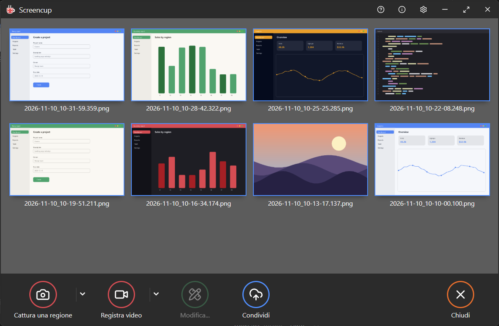
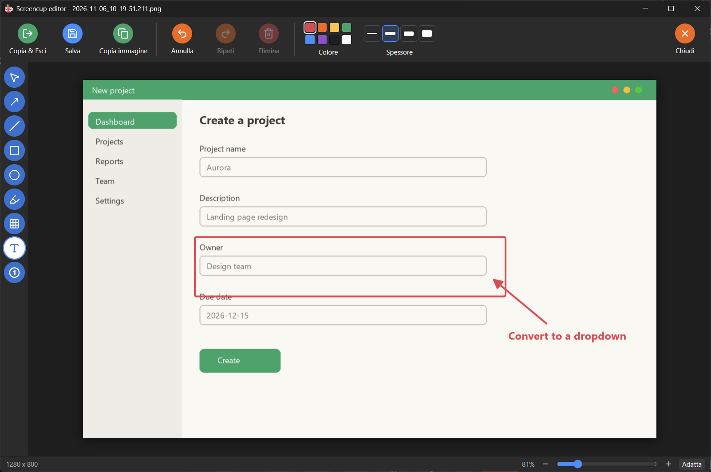

<p align="center">
  
</p>

<h1 align="center">Screencup</h1>

<p align="center">
  Screenshots, annotations and screen recordings from the system tray.<br>
  Built with Tauri (Rust) and React.
</p>

<p align="center">
  
  
</p>

## Features

**Capture**
- Region capture on a frozen screen. Hovering snaps to whole windows, and the mouse wheel
  steps into their panels and controls.
- Full screen, or all screens at once.
- New captures are copied to the clipboard (optional).

**Gallery**
- Opens from the tray icon, anchored to the bottom-right corner of the screen.
- Thumbnails of screenshots and recordings.
- Multi-select with Ctrl/Shift click and Ctrl+A. Delete moves the selection to the trash.
- Optional cap on the number of captures. The oldest ones go to the trash.

**Editor**
- Arrows, lines, rectangles and ellipses (hold Alt for a square or circle), highlighter,
  blur, text and numbered steps.
- Every element stays selectable, movable, resizable, rotatable and deletable, including
  after saving and reopening: the original image is kept and edits are stored separately.
- Copy & close, save, or copy the image to the clipboard.

**Screen recording**
- Records a region or a full screen to MP4 (H.264).
- Before recording, the area is shown with a dashed frame that can be moved and resized,
  next to a panel with microphone, system audio and click-highlight toggles.
- Optional click highlights: a ripple where the mouse is clicked.
- The frame and the panel never appear in the video.

**Settings**
- Language (English, Italian, Spanish, French, German, Portuguese; follows the system by
  default), library folder, start at login, global hotkeys, frame rate, audio sources.

## Default hotkeys

| Action                 | Hotkey               |
| ---------------------- | -------------------- |
| Capture a region       | PrintScreen          |
| Capture the screen     | Shift+PrintScreen    |
| Record a region        | Ctrl+PrintScreen     |
| Record the screen      | Ctrl+Shift+PrintScreen |

All of them can be changed in the settings. Another screenshot tool running in the
background may already own PrintScreen.

## Platform status

| Platform | Status |
| -------- | ------ |
| Windows 10/11 | Main target. Everything above works. |
| macOS, Linux | The code is written cross-platform, but has not been built or tested yet. System audio and click highlights are Windows-only for now. |

## Install

Download `Screencup_<version>_x64-setup.exe` from the
[Releases](https://github.com/goodmagma/screencup/releases) page and run it. It installs per
user and needs no administrator rights. The installer is not signed yet, so Windows
SmartScreen may ask for confirmation ("More info", then "Run anyway").

Releases are built by GitHub Actions ([.github/workflows/release.yml](.github/workflows/release.yml))
when a `v*` tag is pushed.

## Build from source

Requirements:

- [Rust](https://rustup.rs) (stable)
- [Node.js](https://nodejs.org) 20 or newer
- [ffmpeg](https://ffmpeg.org/download.html), which is bundled with the app for recording.
  Point `SCREENCUP_FFMPEG` at the executable, or have it on `PATH`.
- Windows: the WebView2 runtime (preinstalled on Windows 11)

```bash
npm install
```

Run in development:

```bash
npx tauri dev
```

Build the installer (`target/release/bundle/nsis/Screencup_<version>_x64-setup.exe`):

```bash
npx tauri build
```

Both commands first run `npm run build:sidecars`, which does three things:
- builds the native overlay in release
- copies ffmpeg next to the app
- collects the third-party licences

## Project layout

```
crates/overlay/     Native frozen-screen region selector (winit + softbuffer), with window snapping
src-tauri/          Tauri app: tray, capture, library, recorder, audio, hotkeys, settings
src/                React UI: gallery, editor (Konva), recording panel and frame, settings
scripts/            Build helpers: sidecar preparation, licence collection
```

## License

Screencup is released under the [MIT License](LICENSE).

The installer bundles ffmpeg, a separate program under its own licence (GPL for the default
build). See [THIRD-PARTY-NOTICES.md](THIRD-PARTY-NOTICES.md).
